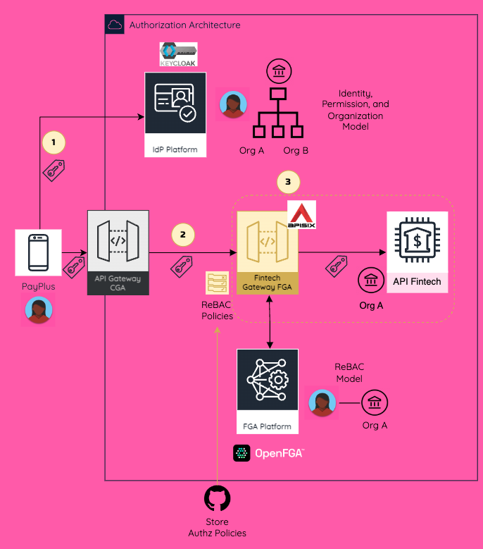
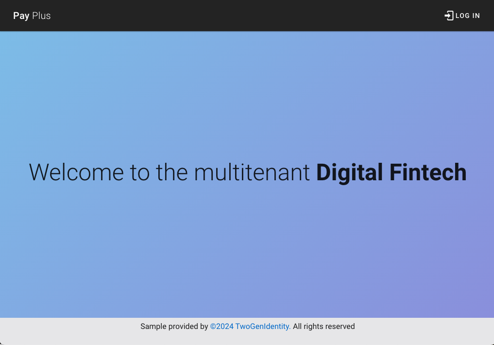
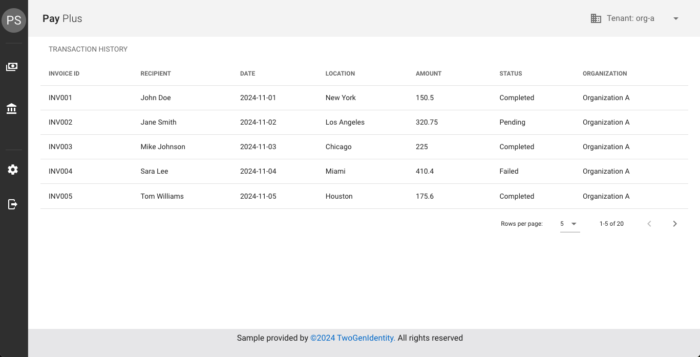

# Building Scalable Multi-Tenancy Authentication and Authorization using Open Standards and Open-Source Software: Keycloak, OpenFGA and Apache APISIX

A hands-on workshop for multi-tenant SaaS authorization with open standards and open-source software. [Keycloak](https://www.keycloak.org/) Organizations model the tenants. The [keycloak-openfga-event-publisher](https://github.com/embesozzi/keycloak-openfga-event-publisher) extension publishes roles and organization membership to [OpenFGA](https://openfga.dev/). [Apache APISIX](https://apisix.apache.org/) allows a request to a tenant's API only if the user has the role **and** belongs to that tenant.

The workshop is based on the article [Building Scalable Multi-Tenancy Authentication and Authorization using Open Standards and Open-Source Software](https://embesozzi.medium.com/building-scalable-multi-tenancy-authentication-and-authorization-using-open-standards-and-7341fcd87b64), which explains the architecture in detail.

> [!TIP]
> ### New: extending fine-grained authorization to AI agents
>
> **Fine-grained authorization doesn't stop at users. AI agents need it too.**
>
> When an agent calls MCP tools on behalf of a user, the questions of this workshop come back, with more at stake:
> **who** is calling (the user, the agent, or both), **what** can they do (which tool, on which resource), and **where** is it enforced.
>
> **[Agentic Security Labs](https://github.com/embesozzi/agentic-security-labs)**: hands-on Docker labs that secure MCP tools with open standards, no custom protocols:
>
> - **MCP tool authorization**: [Agent Gateway](https://agentgateway.dev/) is the Policy Enforcement Point (PEP) in front of the MCP server: it asks Keycloak to allow or deny each `tools/call`, per tool and per user.
> - **OpenID AuthZEN**: the standard API between the PEP and the PDP, with Keycloak as the AuthZEN Policy Decision Point. Change the PDP without changing the gateway.
> - **Cedar policies in Keycloak**: the [Keycloak Cedar provider](https://github.com/embesozzi/keycloak-cedar-authorization) brings [Cedar](https://www.cedarpolicy.com/) to Keycloak authorization: readable policy as code, RBAC and ABAC in one language, policies validated against a schema, and a formally verified engine.
>
> **Read more**
>
> - [Implementing OpenID AuthZEN in Agent Gateway: MCP Tool Authorization](https://embesozzi.github.io/posts/martin-besozzi/implementing-openid-authzen-in-agentgateway/)
> - [Cedar Policy Engine in Keycloak: Fine-Grained Authorization for Users and AI Agents via AuthZEN](https://embesozzi.github.io/posts/martin-besozzi/keycloak-cedar-authorization-authzen/)
> - [AI Agents Require Runtime Authorization: Just In Time Passkey Approval for Sensitive Actions](https://embesozzi.github.io/posts/martin-besozzi/ai-agents-runtime-jit-authorization-passkeys-sensitive-actions/)
> - More on the blog: [embesozzi.github.io](https://embesozzi.github.io/) · all links in [More workshops, labs and articles](#more-workshops-labs-and-articles)

## Architecture



* **Keycloak** authenticates users with OpenID Connect. Its [Organizations](https://www.keycloak.org/docs/latest/server_admin/#_managing_organizations) feature models the tenants (`org-a`, `org-b`), and the `organization` scope adds the user's organizations to the tokens.
* **keycloak-openfga-event-publisher** (3.2.0) listens to Keycloak admin events and publishes them to OpenFGA:
  * role assignments and composite roles: `user:<id> assignee role:<name>`, `role:<parent> parent role:<child>`,
  * organization membership: `user:<id> member organization:<alias>`.
* **OpenFGA** answers the checks against the [authorization model](openfga/model.dsl).
* **Apache APISIX** with the [authz-openfga](https://github.com/embesozzi/apisix-authz-openfga) plugin protects each tenant route with several checks combined with `AND` (or `OR`), see [apisix/routes.yaml](apisix/routes.yaml).
* **PayPlus portal**: a Vue app that signs users in with Keycloak and shows the transactions of their organization.

<details>
<summary>Authorization model</summary>

```
model
  schema 1.1
type client
type group
  relations
    define assignee: [user, client]
type organization
  relations
    define member: [user]
type role
  relations
    define assignee: [user, client] or assignee from parent or assignee from parent_group
    define parent: [role]
    define parent_group: [group]
type user
```

</details>

<details>
<summary>Tenant route: role AND organization</summary>

```yaml
- uris: ["/api/org-a/transactions"]
  plugins:
    authz-openfga:
      check:
        condition: AND
        tuples:
        - user_id: claim::sub
          relation: assignee
          object_type: role
          object_id: view_transaction_any
        - user_id: claim::sub
          relation: member
          object_type: organization
          object_id: org-a
```

</details>

## Quick start

Requires Git, Docker with Docker Compose, and `make`. The workshop uses the host ports `4000`, `8080`, `8081` and `9080`, the same as [keycloak-openfga-workshop](https://github.com/embesozzi/keycloak-openfga-workshop): run one workshop at a time.

| Component | Version |
|-----------|---------|
| Keycloak | 26.8.2 |
| keycloak-openfga-event-publisher | [3.2.0](https://github.com/embesozzi/keycloak-openfga-event-publisher/releases/tag/v3.2.0) |
| OpenFGA | v1.23.0 |

Versions are set in [.env](.env).

**1. Clone the repository**

```shell
git clone https://github.com/embesozzi/keycloak-openfga-multitenancy-workshop
cd keycloak-openfga-multitenancy-workshop
```

**2. Add the workshop hosts to your hosts file** (`/etc/hosts`)

```
127.0.0.1  payplus.lab keycloak openfga
```

**3. Start the workshop**

```shell
make up      # or: docker compose up -d --build
```

Run `make` to list all targets (`up`, `down`, `restart`, `logs`, `test`, `clean`). This builds Keycloak with the extension ([keycloak/Dockerfile](keycloak/Dockerfile) downloads release 3.2.0 and checks its checksum), creates the `keycloak` store and the model in OpenFGA, and creates the `PayPlus` realm with its organizations, roles and users ([keycloak/init.sh](keycloak/init.sh)). The extension publishes them to OpenFGA.

**4. Open the workshop**

| Component | URL | Credentials |
|-----------|-----|-------------|
| PayPlus portal | http://payplus.lab:4000 | `paula.smith` / `demo1234!` |
| Keycloak Admin Console | http://keycloak:8081/admin | `admin` / `password` |
| OpenFGA API | http://localhost:8080 | |
| Apache APISIX | http://localhost:9080 | |

**5. Stop the workshop**

```shell
make down    # or: docker compose down -v
```

## What the workshop sets up

### Keycloak (realm `PayPlus`)

* Organizations enabled, with `org-a` (domain `orga.com`) and `org-b` (domain `orgb.com`).
* Roles: `account-manager`, a composite of `view_transaction_any`.
* User `paula.smith` (password `demo1234!`): has `account-manager` and is a member of `org-a`.
* The `openfga-events-publisher` event listener is enabled.

### OpenFGA

After the import, the `keycloak` store has these tuples:

| User | Relation | Object |
|------|----------|--------|
| `role:account-manager` | `parent` | `role:view_transaction_any` |
| `user:<paula's id>` | `assignee` | `role:account-manager` |
| `user:<paula's id>` | `member` | `organization:org-a` |

Users are identified by their Keycloak id (the `sub` claim) and organizations by their alias (a key of the `organization` claim).

<details>
<summary>Read the tuples</summary>

```shell
STORE_ID=$(curl -s http://localhost:8080/stores | jq -r '.stores[] | select(.name == "keycloak") | .id')
curl -s -X POST http://localhost:8080/stores/$STORE_ID/read -H 'content-type: application/json' -d '{}' \
  | jq -r '.tuples[].key | "\(.user) \(.relation) \(.object)"'
```

</details>

## Use cases

| User | Role | Organization | `GET /api/org-a/transactions` | `GET /api/org-b/transactions` |
|------|------|--------------|:---:|:---:|
| Paula | `account-manager` | `org-a` | ✅ | ❌ |

<details>
<summary><b>Use case 1:</b> Paula views the transactions of her organization</summary>

1. Open the [PayPlus portal](http://payplus.lab:4000) and sign in with Keycloak as `paula.smith` / `demo1234!`.
2. The token's `organization` claim holds `org-a`, so the portal calls `GET /api/org-a/transactions`.
3. APISIX asks OpenFGA both questions: is Paula `assignee` of `role:view_transaction_any` (through `account-manager`), **and** `member` of `organization:org-a`? Both are allowed, so APISIX returns the transactions.

    

</details>

<details>
<summary><b>Use case 2:</b> Paula cannot view the transactions of another organization</summary>

1. Call the API of `org-b` with Paula's token.
2. Paula has the role, but she is not a member of `org-b`, so the `AND` check fails and APISIX returns `403`.

    

</details>

<details>
<summary><b>Try it:</b> add Paula to org-b and watch OpenFGA follow</summary>

In the [Admin Console](http://keycloak:8081/admin/master/console/#/PayPlus/organizations), open `org-b` > Members > Add member > `paula.smith`. The extension publishes `user:<paula's id> member organization:org-b`, and `GET /api/org-b/transactions` is now allowed. Remove her and the extension deletes the tuple.

</details>

## Automated test

[tests/test_workshop.py](tests/test_workshop.py) (pytest) checks the running workshop end to end: the tuples in OpenFGA, the `organization` claim in the token, and the tenant routes of APISIX. It runs in a container on the workshop network. CI runs it on every push and pull request.

```shell
make up
make test    # docker run --rm --network keycloak-openfga-multitenancy-workshop_default <tests image>
```

> [!WARNING]
> The import creates a `smoke-test` client with the password grant for the tests. Testing only, not recommended ([RFC 9700](https://www.rfc-editor.org/rfc/rfc9700)).

## More workshops, labs and articles

**Agentic AI security**

* [Agentic Security Labs](https://github.com/embesozzi/agentic-security-labs): hands-on labs for securing AI agents and the MCP tools they call with open identity and authorization standards (Keycloak, OpenID AuthZEN, Cedar, Agent Gateway).
* [Implementing OpenID AuthZEN in Agent Gateway: MCP Tool Authorization](https://embesozzi.github.io/posts/martin-besozzi/implementing-openid-authzen-in-agentgateway/)
* [Cedar Policy Engine in Keycloak: Fine-Grained Authorization for Users and AI Agents via AuthZEN](https://embesozzi.github.io/posts/martin-besozzi/keycloak-cedar-authorization-authzen/), with the [Keycloak Cedar authorization provider](https://github.com/embesozzi/keycloak-cedar-authorization)
* [Agentic AI Security: Protecting Interactive Keycloak MCP App with OpenID AuthZEN Gateway for FGA](https://embesozzi.github.io/posts/martin-besozzi/agentic-ai-security-protecting-interactive-keycloak-mcp-app-with-openid-authzen-gateway/)
* [AI Agents Require Runtime Authorization: Just In Time Passkey Approval for Sensitive Actions](https://embesozzi.github.io/posts/martin-besozzi/ai-agents-runtime-jit-authorization-passkeys-sensitive-actions/)
* [Mastering Secure APIs and AI Agents with Zero Trust and Fine-Grained Authorization Based on OpenID AuthZEN](https://embesozzi.github.io/posts/martin-besozzi/mastering-secure-apis-and-ai-agents-with-zero-trust-and-fine-grained-authorization-based/)

**Keycloak and OpenFGA**

* [keycloak-openfga-workshop](https://github.com/embesozzi/keycloak-openfga-workshop): the first workshop, ReBAC for a product catalog with protection at the API and at the gateway
* [Building Scalable Multi-Tenancy Authentication and Authorization using Open Standards and Open-Source Software](https://embesozzi.medium.com/building-scalable-multi-tenancy-authentication-and-authorization-using-open-standards-and-7341fcd87b64)
* [keycloak-openfga-event-publisher](https://github.com/embesozzi/keycloak-openfga-event-publisher): the Keycloak extension used in this workshop (organization support since 3.2.0)
* [apisix-authz-openfga](https://github.com/embesozzi/apisix-authz-openfga): the APISIX plugin behind the tenant routes
* [Keycloak integration with OpenFGA (based on Zanzibar) for Fine-Grained Authorization at Scale (ReBAC)](https://embesozzi.medium.com/keycloak-integration-with-openfga-based-on-zanzibar-for-fine-grained-authorization-at-scale-d3376de00f9a)
* [Mastering Access Control: Implementing Low-Code Authorization Based on ReBAC and Decoupling Pattern](https://medium.com/@embesozzi/mastering-access-control-implementing-low-code-authorization-based-on-rebac-and-decoupling-pattern-f6f54f70115e)

**More**

* Blog: [embesozzi.github.io](https://embesozzi.github.io/): posts on IAM, passkeys and AI agent security
* Book: [Keycloak: Identity and Access Management for Modern Applications, 2nd Edition](https://www.amazon.com/Keycloak-Identity-Management-Applications-applications-ebook/dp/B0BPY1RDND)
